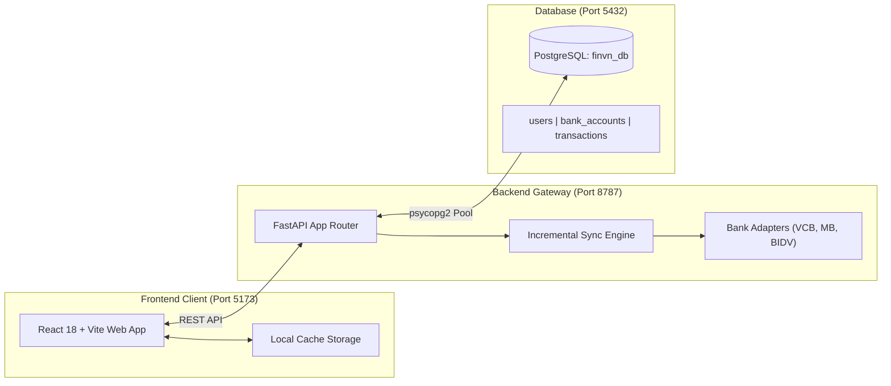

<p align="center">
  
</p>

<h1 align="center">Ứng Dụng Quản Lý Tài Chính Cá Nhân (FinVn)</h1>

<p align="center">
  <b>Giải pháp quản lý tài chính cá nhân thông minh dành cho người Việt — Tự động đồng bộ số dư & lịch sử giao dịch ngân hàng thời gian thực</b>
</p>

<p align="center">
  
  
  
  
</p>

> 📅 **Ngày tạo dự án**: 16/10/2026 *(Khởi tạo Git: 22/10/2026)*  
> 👤 **Tác giả**: Huỳnh Thanh Phong ([@phonghuynh031226](https://github.com/phonghuynh031226))  
> 🔗 **Kho mã nguồn**: [phonghuynh031226/FinVN](https://github.com/phonghuynh031226/FinVN)

---

## 🌟 Tổng Quan Dự Án

**FinVn** là ứng dụng quản lý tài chính cá nhân được thiết kế hiện đại, tinh gọn và bảo mật cao, giải quyết trọn vẹn bài toán ghi chép sổ thu chi thủ công tốn thời gian. Bằng việc kết nối trực tiếp với cổng ngân hàng điện tử (Vietcombank, MBBank, BIDV), FinVn giúp bạn tự động nắm bắt toàn bộ dòng tiền của mình mọi lúc, mọi nơi.

### 💡 Điểm Đột Phá: Kiến Trúc Đồng Bộ Gia Tăng (Incremental Sync)
- **Vấn đề thường gặp**: Mỗi khi người dùng bấm lọc hoặc chạy cron định kỳ, các ứng dụng thông thường thường gửi request quét toàn bộ 30 - 90 ngày lên ngân hàng, dễ gây nghẽn mạng và khiến ngân hàng gắn cờ spam / khóa phiên truy cập.
- **Giải pháp FinVn**: Hệ thống tự động kiểm tra ngày giao dịch gần nhất trong PostgreSQL. Khi kích hoạt đồng bộ, Backend **chỉ lấy các giao dịch phát sinh từ ngày gần nhất đến hiện tại (1 - 2 ngày)**. Giảm đến **95% tải request**, tăng tốc độ phản hồi chỉ còn vài giây và loại bỏ hoàn toàn nguy cơ bị ngân hàng chặn.

---

## ✨ Tính Năng Nổi Bật

### 💳 1. Quản lý Đa Tài Khoản Ngân Hàng
- Hỗ trợ kết nối các ngân hàng hàng đầu tại Việt Nam: **Vietcombank**, **MBBank**, **BIDV**.
- Tùy chỉnh màu sắc thẻ, đặt tên gợi nhớ cá nhân hóa (*"Lương"*, *"Tiết kiệm"*, *"Chơi"*, *"Gia đình"*...).
- Che thông minh số tài khoản (chỉ hiện 4 số cuối, ví dụ: `****6253`).
- **Xóa thẻ an toàn (Soft-Delete)**: Ẩn tài khoản khỏi danh sách nhưng bảo toàn 100% lịch sử giao dịch để không gây sai lệch số liệu thống kê thu chi trong quá khứ.

### ⚡ 2. Đồng Bộ Tự Động & Chống Trùng Tuyệt Đối
- Đồng bộ số dư thực tế và lịch sử giao dịch tức thì.
- **Cơ chế Idempotent Deduplication**: Ứng dụng ràng buộc độc nhất `UNIQUE(account_id, reference)` trong PostgreSQL. Đảm bảo dù đồng bộ nhiều lần, không bao giờ xảy ra tình trạng trùng lặp hay ghi đè sai lệch dữ liệu.
- Tự động nạp dữ liệu mượt mà từ bộ nhớ trình duyệt (`localStorage`) lên Database mà không làm gián đoạn trải nghiệm người dùng.

### 📊 3. Báo Cáo Phân Tích & Quản Lý Thu Chi
- Phân loại rõ ràng và minh bạch:
  - `Tổng số dư`: Số dư thực có trong các ví/tài khoản.
  - `Tiền vào (+)`: Tổng thu nhập thực tế trong kỳ lọc.
  - `Tiền ra (-)`: Tổng chi tiêu thực tế trong kỳ lọc.
  - `Chênh lệch`: Dòng tiền ròng (Thu - Chi).
- Tùy biến bộ lọc thời gian: **Hôm nay**, **7 ngày qua**, **30 ngày qua**, **Tháng này**, hoặc khoảng ngày tự chọn.
- Cho phép chỉnh sửa danh mục phân loại chi tiêu và ghi chú cá nhân mà **bảo toàn nguyên vẹn nội dung gốc** từ ngân hàng.

---

## 🏗️ Kiến Trúc Hệ Thống



---

## 🛠️ Yêu Cầu Hệ Thống

- **Node.js**: Phiên bản 18.x trở lên.
- **Python**: Phiên bản 3.10 trở lên.
- **PostgreSQL**: Phiên bản 14 trở lên (khuyên dùng PostgreSQL 16 hoặc 17).

---

## 🚀 Hướng Dẫn Cài Đặt & Khởi Chạy

### 1️⃣ Bước 1: Khởi tạo Cơ sở dữ liệu PostgreSQL

1. Mở **pgAdmin 4** (hoặc `psql`) và tạo database mới:
   ```sql
   CREATE DATABASE finvn_db;
   ```
2. Mở file [`sql/init_postgres.sql`](./sql/init_postgres.sql) và chạy toàn bộ nội dung script để tạo các bảng `users`, `bank_accounts`, `transactions` cùng các chỉ mục tối ưu hóa.

---

### 2️⃣ Bước 2: Cấu hình và Khởi chạy Backend Gateway

1. Di chuyển vào thư mục backend:
   ```bash
   cd "backend"
   ```
2. Cài đặt các thư viện cần thiết:
   ```bash
   pip install -r requirements.txt
   ```
3. Tạo file `backend/.env` với cấu hình kết nối database của bạn:
   ```ini
   DB_HOST=localhost
   DB_PORT=5432
   DB_NAME=finvn_db
   DB_USER=postgres
   DB_PASSWORD=your_password
   ```
4. Khởi động máy chủ Backend API:
   ```bash
   python -m uvicorn backend.app.main:app --port 8787 --reload
   ```
   API sẽ chạy tại: `http://localhost:8787` (Tài liệu Swagger: `http://localhost:8787/docs`).

---

### 3️⃣ Bước 3: Cấu hình và Khởi chạy Frontend Web App

1. Mở một cửa sổ dòng lệnh mới và di chuyển vào thư mục web:
   ```bash
   cd "frontend/web"
   ```
2. Cài đặt các gói npm:
   ```bash
   npm install
   ```
3. Tạo file cấu hình `frontend/web/.env.local`:
   ```ini
   VITE_BANK_CONNECTOR_URL=http://localhost:8787
   ```
4. Chạy môi trường phát triển (Development):
   ```bash
   npm run dev
   ```
   Mở trình duyệt và truy cập: **`http://localhost:5173/`**

---

## 📡 Danh Sách API Endpoints Chính

| Phương thức | Endpoint | Mô tả |
| :--- | :--- | :--- |
| `POST` | `/api/banks/{bank}/sync` | Đồng bộ gia tăng số dư & giao dịch từ ngân hàng vào PostgreSQL |
| `GET` | `/api/accounts` | Lấy danh sách tài khoản ngân hàng hoạt động của người dùng |
| `POST` | `/api/accounts` | Thêm tài khoản ngân hàng mới |
| `DELETE` | `/api/accounts/{id}` | Xóa mềm tài khoản ngân hàng (bảo toàn lịch sử giao dịch) |
| `GET` | `/api/transactions` | Lấy danh sách giao dịch có phân trang và lọc theo khoảng ngày |
| `PUT` | `/api/transactions/{id}` | Cập nhật phân loại danh mục hoặc ghi chú cá nhân của giao dịch |
| `POST` | `/api/migrate-from-local` | Đẩy toàn bộ dữ liệu từ trình duyệt người dùng vào PostgreSQL |

---

## 🛡️ Cam Kết Bảo Mật & Quyền Riêng Tư

- Mọi thông tin tài khoản và giao dịch tài chính được lưu trữ trực tiếp trên cơ sở dữ liệu nội bộ (Local Database) của chính bạn, không chuyển tiếp qua bất kỳ máy chủ bên thứ ba nào.
- Thông tin đăng nhập ngân hàng chỉ được sử dụng cho phiên tương tác xác thực và không lưu trữ mật khẩu tĩnh ở dạng thô.

---

## 📄 Bản Quyền & Giấy Phép

Dự án được phát triển phục vụ mục đích cá nhân và học tập bởi **Huỳnh Thanh Phong** (@phonghuynh031226).
Mọi quyền sở hữu trí tuệ thuộc về tác giả.
